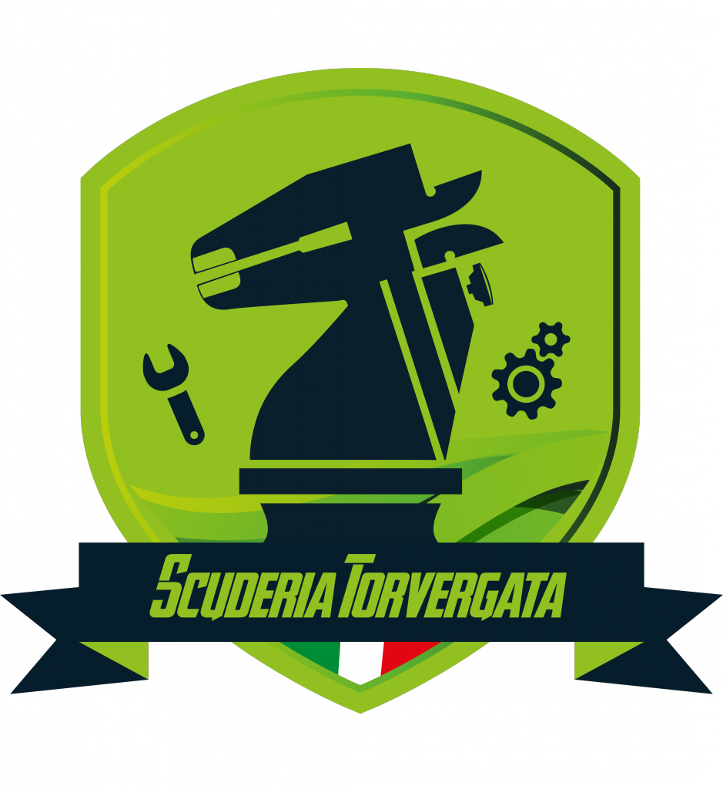
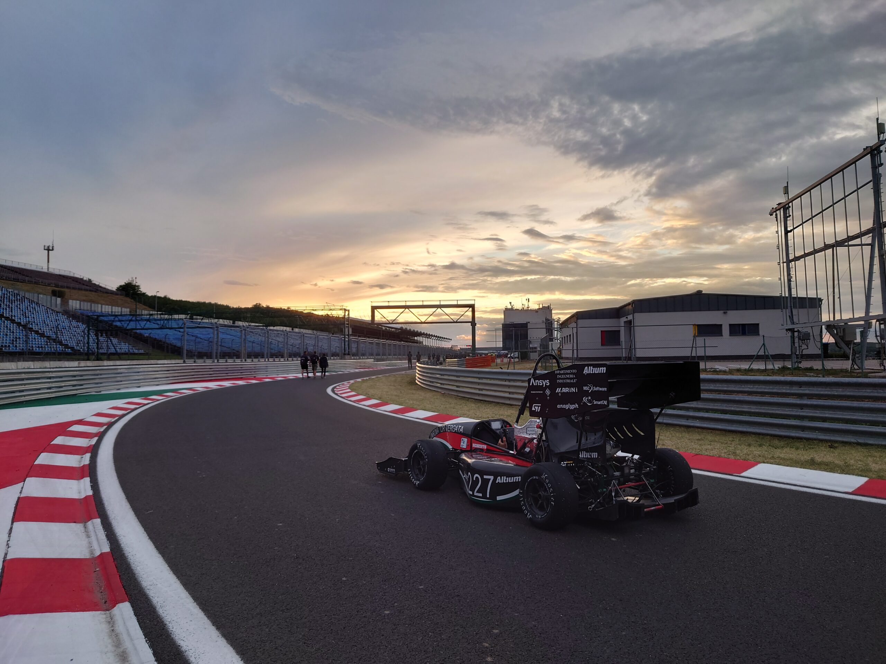
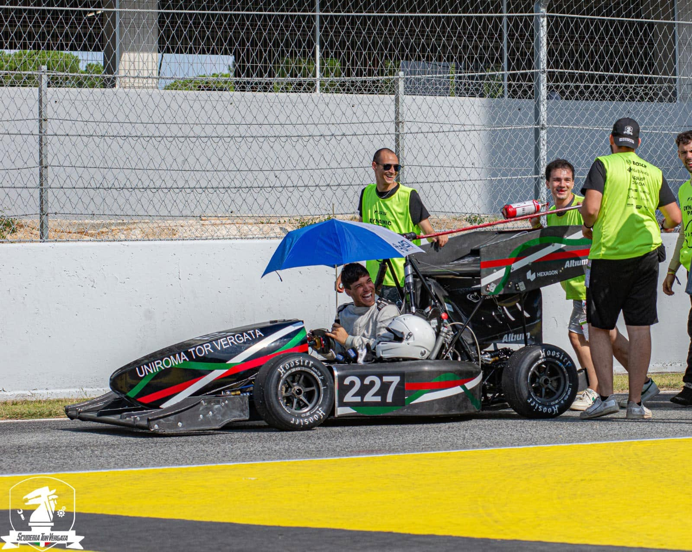
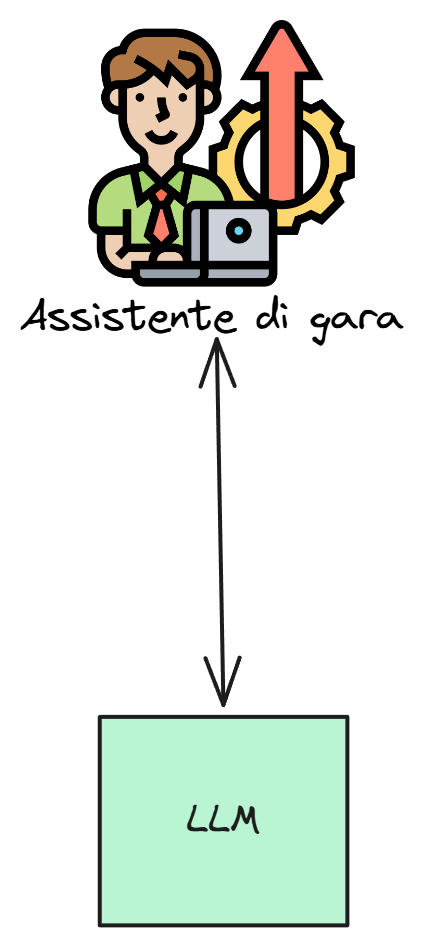
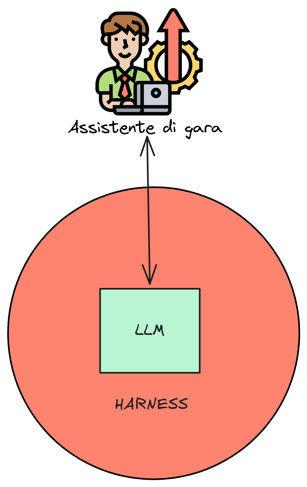
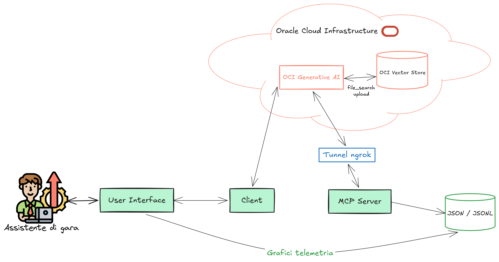
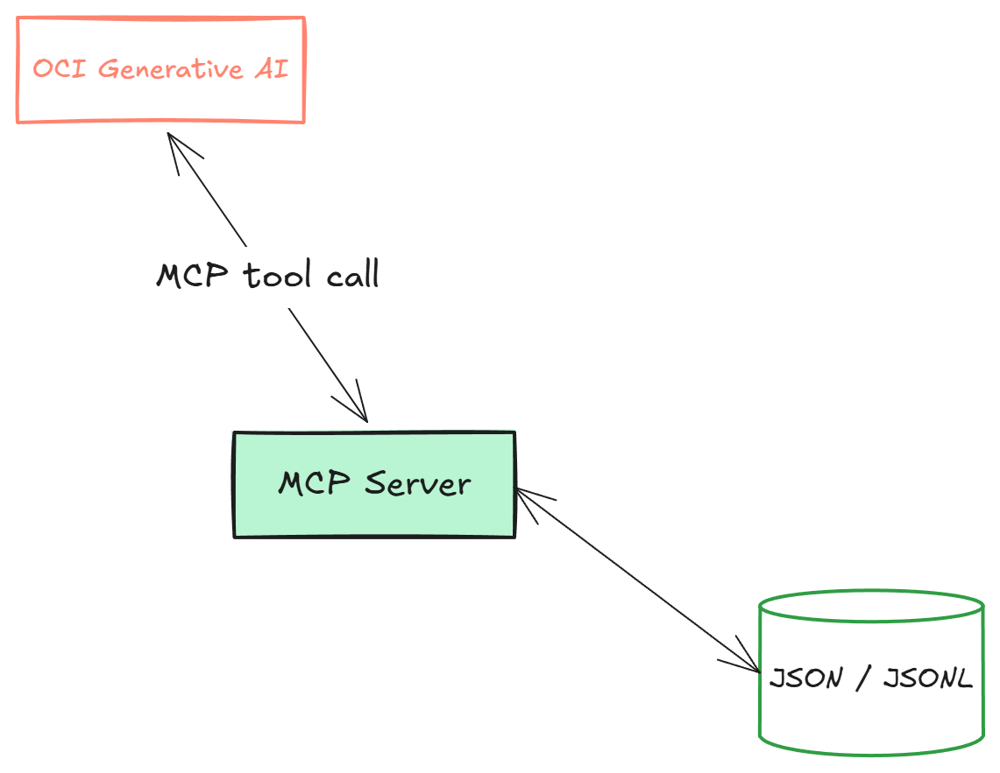
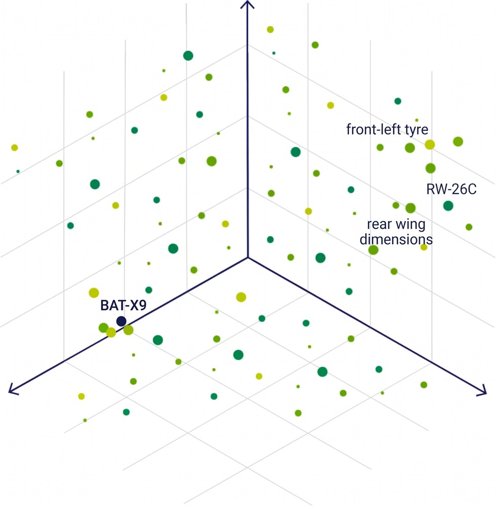
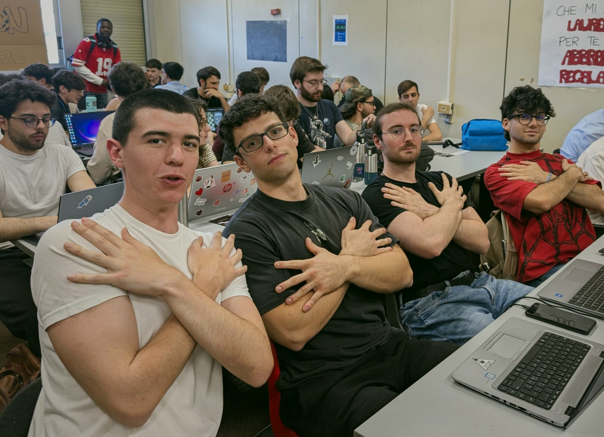

## AI Race<br>Engineer<br>Copilot {.cover .cover-long data-background-color="#003517"}

::: {.eyebrow}
SCUDERIA TOR VERGATA
:::

::: {.cover-copy}
Un assistente per l'ingegnere di pista,<br>costruito su OCI Enterprise AI
:::

::: {.cover-rule}
:::

::: {.cover-team}
Team Struffoli<br>
Valerio Bernardi · Alfredo Grande<br>
Samuele De Santis · Luca Gugliotta
:::

::: {.cover-logos}
{.crest alt="Stemma della Scuderia Tor Vergata"}
{.oracle alt="Oracle"}
:::

{.cover-photo alt="Monoposto della Scuderia su un circuito al tramonto"}

<div class="cover-cut" aria-hidden="true"></div>

::: {.cover-caption}
{.caption-icon alt=""} HACKATHON CON ORACLE · 22/05/2026
:::

::: {.notes}
Buongiorno a tutti. Siamo il team Struffoli: Valerio, Alfredo, Samuele e Luca. Vi presentiamo l'AI Race Engineer Copilot, un assistente per l'ingegnere di pista della Scuderia Tor Vergata, costruito sulla piattaforma OCI Enterprise AI.
:::

## Obiettivo del progetto {.plain}

::: {.eyebrow}
[01]{.section-number} OBIETTIVO
:::

::: {.subtitle}
Un chatbot operativo a supporto della Scuderia Tor Vergata.
:::

::: {.brief-grid}
::: {.goal-list}
::: {.issue}
[{.title-icon alt=""} Contesto real-time]{.issue-title}

Analisi immediata dei dati di gara e del regolamento.
:::

::: {.issue}
[{.title-icon alt=""} Nessuna allucinazione]{.issue-title}

Esposizione esclusiva di dati e numeri effettivamente recuperati.
:::

::: {.issue}
[{.title-icon alt=""} Incertezza dichiarata]{.issue-title}

Assenza di informazioni notificata esplicitamente all'utente.
:::
:::

::: {.brief-photo}
{alt="Il team della Scuderia ai box con il pilota a bordo della monoposto"}

::: {.caption}
Scuderia Tor Vergata · box e pit lane
:::
:::
:::

::: {.notes}
Durante una gara l'ingegnere di pista deve decidere in pochi secondi, e le informazioni arrivano da due mondi diversi: la telemetria, cioè cosa sta facendo la macchina adesso, e il regolamento, cioè cosa la macchina può fare. Sono fonti distanti, con formati diversi, e un errore su una delle due costa la gara o la squalifica.
Ci siamo dati tre obiettivi: risposte basate su dati reali, verifiche normative con la fonte citata, e soprattutto dichiarare l'incertezza invece di inventare.
Il nostro criterio di successo non era rispondere bene, ma rispondere solo con ciò che si può dimostrare.
:::

## Due fonti, due formati {.cards-slide .plain}

::: {.eyebrow}
[01]{.section-number} FONTI E DATI
:::

::: {.card-grid .two .sources}

::: {.info-card}

::: {.card-header}
[01]{.card-num} [DATI DI GARA]{.card-step} {.card-icon alt=""}
:::

### Telemetria

::: {.card-desc}
Dati dinamici sulle condizioni del veicolo a ogni pit di gara.
:::

::: {.format-block}
[JSON]{.format-num}
:::

:::

::: {.info-card}

::: {.card-header}
[02]{.card-num} [DOCUMENTI]{.card-step} {.card-icon alt=""}
:::

### Regolamento

::: {.card-desc}
Dossier tecnico e normativo per le verifiche dei veicoli in gara.
:::

::: {.format-block}
[PDF]{.format-num}
:::

:::

:::

::: {.notes}
Abbiamo lavorato su tre fonti: la telemetria di una gara simulata di cinquanta giri a Vallelunga, il regolamento tecnico-sportivo e il dossier tecnico della vettura. Il dataset nasconde una storia precisa: dopo la safety car la gomma anteriore sinistra comincia a consumarsi più del previsto. Al giro 23 l'usura è al 61 %, contro il 43 % atteso: diciotto punti di scarto, la nostra soglia critica. Nel dossier ci sono poi tre componenti sperimentali da verificare contro il regolamento.
I vincoli: dati simulati, un server da rendere raggiungibile dal cloud senza porte aperte, e nessun accesso alla console. Per questo abbiamo lavorato direttamente via API, come si fa in produzione.
:::

## Task progettuali {.cards-slide .plain}

::: {.eyebrow}
[01]{.section-number} GLI OBIETTIVI
:::

::: {.subtitle}
L'architettura del copilota sviluppata in tre task.
:::

::: {.card-grid .phases}

::: {.info-card}

::: {.card-header}
[01]{.card-num} [TASK 1]{.card-step} {.card-icon alt=""}
:::

### Server MCP

::: {.card-desc}
Sviluppo di tool di estrazione per analizzare i dati JSON della telemetria.
:::

:::

::: {.info-card}

::: {.card-header}
[02]{.card-num} [TASK 2]{.card-step} {.card-icon alt=""}
:::

### RAG normativo

::: {.card-desc}
Chunking dei PDF e verifica della conformità tramite ricerca semantica.
:::

:::

::: {.info-card}

::: {.card-header}
[03]{.card-num} [TASK 3]{.card-step} {.card-icon alt=""}
:::

### App unificata

::: {.card-desc}
Collegamento del chatbot con server e RAG, e web app Streamlit per porre query all'assistente.
:::

:::

:::

::: {.notes}
Task 1 — Server MCP (Analisi della telemetria): L'obiettivo di questo task è rispondere a domande sulla telemetria di gara. Per farlo, è stato sviluppato un server MCP (Model Context Protocol) che interroga i dati di gara (come i tempi sul giro e l'usura delle gomme) e calcola le strategie dei pit stop. Utilizza la Responses API per far sì che il modello legga i dati reali e strutturati esposti dall'MCP e usi funzioni deterministiche anziché inventare i numeri.
Task 2 — RAG di compliance (Verifica normativa): Il secondo task ha l'obiettivo di verificare la conformità dei componenti della vettura rispetto al regolamento tecnico-sportivo. Questo avviene tramite un sistema RAG (Retrieval-Augmented Generation) supportato da OCI Vector Store e dalla funzionalità File Search. I documenti forniti, come il regolamento e il dossier tecnico, vengono frammentati (chunking) e indicizzati affinché il modello possa recuperare i passaggi pertinenti ed emettere un verdetto citando le sezioni esatte.
Task 3 — Race Engineer Copilot (Sistema unificato con interfaccia web): L'ultimo task unisce i due sistemi precedenti in un copilota AI accessibile tramite una web app sviluppata con Streamlit. In questa fase, il client esegue un'unica richiesta orchestrando contemporaneamente sia i tool del server MCP sia il File Search. L'interfaccia fornisce all'utente una dashboard completa con grafici sull'andamento della gara, la possibilità di caricare nuovi PDF per aggiornare le conoscenze normative, e una chat interattiva per interrogare l'assistente su strategie operative e conformità del veicolo.
:::

## Un LLM da solo non basta {.harness-slide .plain}

::: {.eyebrow}
[02]{.section-number} PERCHÉ UN SISTEMA
:::

::: {.subtitle}
Perché non mettere tutto nel prompt?
:::

::: {.harness-text}
::: {.lead}
Abbiamo **due fonti di informazione molto diverse**: metterle tutte nel prompt renderebbe il sistema poco efficiente e poco controllabile.
:::

::: {.source-duo}
::: {.source-box}
{.source-icon alt=""}

::: {.source-info}
[Telemetria]{.source-title}
:::
:::

::: {.source-box}
{.source-icon alt=""}

::: {.source-info}
[Documenti]{.source-title}
:::
:::
:::

::: {.issue-grid}
::: {.issue}
[{.title-icon alt=""} Token sprecati]{.issue-title}

Context window piena di dati inutili
:::

::: {.issue}
[{.title-icon alt=""} Poco controllo]{.issue-title}

Il modello cerca da solo nel contesto
:::

::: {.issue}
[{.title-icon alt=""} Valori inventati]{.issue-title}

Calcoli approssimativi e regole non verificate
:::
:::
:::

::: {.harness-figure}
{.fig-before alt="L'assistente di gara parla direttamente con un LLM"}
:::

::: {.notes}
La domanda sorge spontanea: per rispondere al problema non sarebbe sufficiente utilizzare un semplice LLM a cui facciamo delle domande sulle varie telemetrie, magari mettendo direttamente nel system prompt tutto il contesto che deve avere, come dati di gara, regolamento e informazioni tecniche?
La risposta è no, o comunque non sarebbe l'approccio migliore. Abbiamo infatti due fonti di informazione molto diverse e soprattutto mettere tutto dentro al prompt produrrebbe un approccio poco efficiente e poco controllabile.
L'obiettivo è: ridurre l'uso inutile di token; far lavorare il modello solo con le informazioni che effettivamente gli servono; evitare di riempire la context window con dati non rilevanti.
Trattare tutto allo stesso modo significherebbe chiedere al modello di cercare da solo l'informazione utile dentro un grande blocco di contesto.
Inoltre non vogliamo che il modello inventi valori, faccia calcoli approssimativi o interpreti una regola basandosi soltanto sulla propria conoscenza generale. Vogliamo invece che recuperi i dati reali da una fonte precisa e che, quando possibile, i calcoli vengano eseguiti da codice deterministico.
Il valore aggiunto quindi non è semplicemente dare al modello più contesto possibile, ma costruire un sistema che gli permetta di recuperare l'informazione giusta, dalla fonte giusta, nel momento giusto.
:::

## Costruire un harness attorno all'LLM {.harness-slide .plain}

::: {.eyebrow}
[02]{.section-number} LA SOLUZIONE
:::

::: {.subtitle}
Il modello non è più un chatbot.
:::

::: {.harness-text}
::: {.issue-grid .fix}
::: {.issue}
[{.title-icon alt=""} Orchestratore]{.issue-title}

L'LLM coordina gli strumenti e ragiona
:::

::: {.issue}
[{.title-icon alt=""} Tool dedicati]{.issue-title}

MCP + File Search
:::

::: {.issue}
[{.title-icon alt=""} Separazione dei compiti]{.issue-title}

LLM e tool con responsabilità distinte
:::
:::
:::

::: {.harness-figure}
{.fig-after alt="Lo stesso LLM, ora racchiuso in un harness"}
:::

::: {.notes}
Costruire un harness attorno all'LLM. Il modello non viene più usato come un semplice chatbot, ma diventa un orchestratore che ha il compito di ragionare e interpretare i dati che recupera tramite gli strumenti che gli mettiamo a disposizione.
Noi gli forniamo strumenti specializzati: uno per accedere ai dati di gara e ai calcoli sulla telemetria; uno per recuperare informazioni dai documenti tramite ricerca semantica.
In questo modo separiamo i compiti: l'LLM si occupa di interpretare e ragionare; i tool si occupano di recuperare dati reali ed eseguire operazioni precise; il sistema di retrieval si occupa di recuperare solo il contesto documentale utile.
:::

## Una richiesta, due percorsi {.architecture-final .plain}

::: {.eyebrow}
[02]{.section-number} ARCHITETTURA
:::

::: {.big-figure}
{alt="Architettura: assistente di gara, interfaccia, client, OCI Generative AI con Vector Store, tunnel ngrok, server MCP e dati JSON"}
:::

::: {.key-cards}
::: {.key-card}
[{.key-icon alt=""} OCI Generative AI]{.key-title}

Riceve dal client, via Responses API, il prompt dell'utente e gli strumenti disponibili.
:::

::: {.key-card}
[{.key-icon alt=""} Tool calling]{.key-title}

Il modello decide quali strumenti utilizzare, anche più volte nello stesso flusso. Per la telemetria invoca i tool esposti dal server MCP.
:::

::: {.key-card}
[{.key-icon alt=""} `file_search`]{.key-title}

Tool di retrieval: recupera dall'OCI Vector Store i passaggi più rilevanti per la richiesta.
:::

::: {.key-card}
[{.key-icon alt=""} ngrok]{.key-title}

Tunnel HTTPS: rende il server MCP locale raggiungibile da OCI Generative AI nel cloud.
:::
:::

::: {.notes}
L'ingegnere di gara interagisce con una User Interface, che comunica con un client incaricato di costruire la richiesta da inviare a OCI Generative AI tramite la Responses API.
Alla richiesta non passiamo solamente il prompt dell'utente: rendiamo disponibili al modello anche gli strumenti che può utilizzare durante il ragionamento. I due percorsi principali sono File Search, per recuperare informazioni dai documenti indicizzati nell'OCI Vector Store, e MCP, per invocare i tool esposti dal nostro server e accedere alla telemetria.
Una volta ricevuta la richiesta, il modello può decidere autonomamente quali strumenti utilizzare e può effettuare più chiamate ai tool all'interno dello stesso flusso prima di produrre la risposta finale.
Il server MCP gira localmente sulla nostra macchina, mentre OCI Generative AI è nel cloud. Per renderlo raggiungibile dall'esterno abbiamo utilizzato ngrok, che crea un tunnel HTTPS pubblico verso il server locale.
:::

## I due strumenti: MCP e OCI Vector Store {.cards-slide .plain}

::: {.eyebrow}
[02]{.section-number} TECNOLOGIE
:::

::: {.card-grid .two}

::: {.info-card}

::: {.card-header}
[01]{.card-num} [DATI DI GARA]{.card-step} {.card-icon alt=""}
:::

::: {.card-figure}
{alt="OCI Generative AI chiama il server MCP, che legge i dati JSON e JSONL"}
:::

### MCP Server

::: {.card-desc}
Espone tool per accedere in modo **controllato** a dati esterni ed eseguire calcoli deterministici.
:::

- Telemetria in **JSON / JSONL**
- Standard per descrivere e invocare tool
- Chiamato da **OCI Generative AI** tramite MCP
- Calcoli deterministici eseguiti via codice

:::

::: {.info-card}

::: {.card-header}
[02]{.card-num} [DOCUMENTI]{.card-step} {.card-icon alt=""}
:::

::: {.card-figure}
{alt="Spazio degli embedding: RW-26C vicino a rear wing dimensions, BAT-X9 lontano"}
:::

### OCI Vector Store

::: {.card-desc}
Embedding e ricerca semantica sui documenti.
:::

- Ogni chunk diventa un **vettore multidimensionale**
- Significati simili → vettori **vicini nello spazio**
- **Ricerca semantica** tramite `file_search`
- Indicizzazione e retrieval gestiti da OCI

:::

:::

## I tool MCP {.plain}

::: {.eyebrow}
[03]{.section-number} IMPLEMENTAZIONE
:::

::: {.twin-grid}

::: {.editor}

::: {.editor-bar}
[mcp-server-struffoli.py]{.editor-tab} [TASK 1]{.editor-lang}
:::

```{.python code-line-numbers="1-5"}
@mcp.tool()
def get_lap_window(start_lap: int,
                   end_lap: int) -> Dict[str, Any]:
    """Return a list of lap records between
    start_lap and end_lap, inclusive."""
    meta = _load_json("race_session_telemetry.json")
    result = []
    for lap in meta["laps"]:
        if start_lap <= lap["lap"] <= end_lap:
            result.append(lap)
    return {
        "start_lap": start_lap,
        "end_lap": end_lap,
        "laps_found": len(result),
        "laps": result
    }
```

::: {.editor-note}
**Implementazione dell'MCP tool richiesto dal Task 1:** `get_lap_window`
:::

:::

::: {.editor}

::: {.editor-bar}
[mcp-server-struffoli.py]{.editor-tab} [TASK 3]{.editor-lang}
:::

```{.python code-line-numbers="7-8"}
@mcp.tool()
def recommend_pit_strategy(
        current_lap: int) -> Dict[str, Any]:
    """Analizza strategia e usura per raccomandare
    il momento ottimale del pit stop e stimarne
    l'impatto sulla gara."""
    # calcolo deterministico
    laps_to_limit = (95.0 - current_wear) / deg_rate
    ...
    return {"recommendation": "PIT_IN_WINDOW",
            "target_pit_lap": 27, ...}
```

::: {.editor-note}
**Implementazione di un MCP tool aggiunto per l'interfaccia (Task 3):** `recommend_pit_strategy`
:::

:::

:::

::: {.notes}
A sinistra: implementazione del tool MCP richiesto dal Task 1, get_lap_window.
A destra: un tool MCP che abbiamo aggiunto per offrire funzionalità all'interfaccia grafica del Task 3, recommend_pit_strategy.
Evidenziati: decoratore e docstring (ciò che il modello legge) e il calcolo deterministico.
:::

## L'OCI Vector Store {.plain}

::: {.eyebrow}
[03]{.section-number} OCI VECTOR STORE
:::

::: {.split-grid}

::: {.editor}

::: {.editor-bar}
[upload_file.py]{.editor-tab} [PYTHON]{.editor-lang}
:::

```{.python code-line-numbers="1-2,6-9"}
chunks = chunk_pdf_per_ai(pdf_path,
                          chunk_size=1500, overlap=200)
for i, chunk in enumerate(chunks):
    f = client.files.create(file=to_file(chunk),
                            purpose="user_data")
    client.vector_stores.files.create(
        vector_store_id=VECTOR_STORE_ID, file_id=f.id,
        attributes={"original_file": name,
                    "chunk_index": i})
```

::: {.editor-note}
**Caricamento dei file**, divisi in chunk, nel Vector Store.
:::

:::

::: {.fact-card}

::: {.fact-text}
I file vengono divisi in **chunk di dimensione fissa**, per evitare di superare i limiti di memoria per file imposti dal Vector Store.
:::

::: {.fact-row}
::: {}
[1500]{.fact-num} [caratteri per chunk]{.fact-label}
:::

::: {}
[200]{.fact-num} [caratteri di overlap]{.fact-label}
:::
:::

:::

:::

::: {.notes}
Implementazione del caricamento dei file, divisi in chunk, nel vector store.
I file vengono divisi in chunk di dimensione fissa, per evitare di superare i limiti di memoria per file imposti dal Vector Store.
:::

## Prompt Engineering {.plain}

::: {.eyebrow}
[03]{.section-number} IMPLEMENTAZIONE
:::

::: {.prompt-grid}

::: {.editor}

::: {.editor-bar}
[system prompt]{.editor-tab} [PROMPT]{.editor-lang}
:::

```{.text}
You are an AI Race Engineer Copilot for Scuderia Tor Vergata.
You combine two main capabilities:
1. Race telemetry and strategy analysis through MCP tools.
2. Regulatory compliance and dossier analysis via file_search.
...
Do not guess.
Use MCP tools for structured race data.
Use file_search for regulations, rulebooks, technical dossiers.
If evidence is missing, incomplete or ambiguous, say so explicitly.
Never invent:
- telemetry values
- lap data
...
For every answer, explicitly state which evidence source was used:
- MCP only
- file_search only
- MCP + file_search
- No tool evidence available
...
For compliance answers, provide a documentation support score:
how strongly the available documents support your answer,
NOT how legally compliant the component is.
```

:::

::: {.prompt-rules-card}

::: {.card-header}
[REGOLE DEL COPILOTA]{.card-step}
:::

- Non inventare dati quando non sei sicuro della risposta
- Affidati ai tool MCP e `file_search`
- Dichiara la percentuale di informazioni presa da ogni fonte
- Mostra il ragionamento step by step che farebbe un ingegnere di gara

:::

:::

::: {.notes}
A sinistra: estratti del system prompt (telemetria da MCP, conformità da file_search, trasparenza e quote).
A destra: i 4 principi cardine imposti al copilota durante la risposta.
:::


## L'interfaccia del Race Engineer {.plain}

::: {.eyebrow}
[04]{.section-number} TASK 3 · DEMO
:::

::: {.subtitle}
Una dashboard Streamlit per consultare i dati di gara, interrogare l'assistente e caricare documenti tecnici.
:::

::: {.video-grid .wide-side}

::: {}
<video class="demo-video" src="assets/video/video1.mp4" data-autoplay muted loop playsinline></video>
:::

::: {.editor}

::: {.editor-bar}
[interfaccia.py]{.editor-tab} [PYTHON]{.editor-lang}
:::

```{.python}
tab1, tab2, tab3 = st.tabs(
    ["Lap time", "Energy", "Position"])

with tab1:
    if ("lap_time_s" in df.columns
            and df["lap_time_s"].notna().any()):
        chart_df = (df.set_index("lap")
                    [["lap_time_s"]])
        st.line_chart(chart_df, height=180)
```

::: {.editor-note}
**Un tab per grafico:** tempi, energia, posizione.
:::

:::

:::

::: {.notes}
Video 1: panoramica della dashboard. A destra lo snippet che costruisce i grafici della telemetria.
:::

## Dalla quick action alla risposta {.plain}

::: {.eyebrow}
[04]{.section-number} DEMO · TELEMETRIA
:::

::: {.subtitle}
I dati della gara vengono recuperati tramite MCP e trasformati in una risposta operativa.
:::

::: {.video-grid .flow-grid}

::: {}
<video class="demo-video" src="assets/video/video2.mp4" data-autoplay muted loop playsinline></video>
:::

::: {}

::: {.flow-container}

::: {.flow-phase}
::: {.flow-label}
ANDATA
:::

::: {.flow-steps}
- Streamlit
- client Python
- OCI Responses API
- strumenti MCP
:::
:::

::: {.flow-phase}
::: {.flow-label}
RITORNO
:::

::: {.flow-steps .return-steps}
- risultati MCP
- OCI Responses API
- client Python
- chat Streamlit
:::
:::

:::

:::

:::

::: {.notes}
Video 2: una quick action parte dall'interfaccia, il modello chiama i tool MCP e la risposta torna nella chat.
:::

## Verifica documentale BAT-X9 {.plain}

::: {.eyebrow}
[04]{.section-number} DEMO · REGOLAMENTO
:::

::: {.subtitle}
Un secondo percorso per il modello: file_search apre l'accesso ai documenti.
:::

::: {.video-grid .flow-grid}

::: {}
<video class="demo-video" src="assets/video/video3.mp4" data-autoplay muted loop playsinline></video>
:::

::: {}

::: {.flow-container}

::: {.flow-phase}
::: {.flow-label}
ANDATA
:::

::: {.flow-steps}
- Streamlit
- client Python
- OCI Responses API
- `file_search` → documenti
:::
:::

::: {.flow-phase}
::: {.flow-label}
RITORNO
:::

::: {.flow-steps .return-steps}
- passaggi recuperati
- OCI Responses API
- client Python
- chat Streamlit
:::
:::

:::

:::

:::

::: {.notes}
Video 3: la domanda sul pacco batterie BAT-X9 passa da file_search sui documenti indicizzati.
:::

## La fonte dipende dalla domanda {.cards-slide .plain}

::: {.eyebrow}
[04]{.section-number} RISULTATI
:::

::: {.subtitle}
Una sola Responses API, due percorsi di evidenza.
:::

::: {.card-grid .two}

::: {.info-card .compare-card}

::: {.card-header}
[01]{.card-num} [TELEMETRIA]{.card-step} {.card-icon alt=""}
:::

### Analisi dello pneumatico e pit stop

::: {.source-mix}

::: {.source-stat-row}
::: {.source-stat-lead}
[100%]{.source-pct} [MCP]{.source-label-lead}
:::
::: {.source-stat-zero}
0% file_search
:::
:::

::: {.source-bar}
[]{.seg-a style="width: 100%"}
:::

:::

::: {.compare-row}
[DATO]{.action-label} Usura **61,4 %** contro **43,1 %** atteso
:::

::: {.compare-row}
[RISPOSTA]{.action-label} Sosta proposta tra i giri **24 e 27**
:::

:::

::: {.info-card .compare-card}

::: {.card-header}
[02]{.card-num} [REGOLAMENTO]{.card-step} {.card-icon alt=""}
:::

### Verifica BAT-X9

::: {.source-mix}

::: {.source-stat-row}
::: {.source-stat-lead}
[100%]{.source-pct} [file_search]{.source-label-lead}
:::
::: {.source-stat-zero}
0% MCP
:::
:::

::: {.source-bar}
[]{.seg-b style="width: 100%"}
:::

:::

::: {.compare-row}
[DOCUMENTO TROVATO]{.action-label} Dossier BAT-X9
:::

::: {.compare-row}
[RISPOSTA]{.action-label} Conformità non confermata: norma decisiva non recuperata
:::

:::

:::

::: {.notes}
Stesso sistema, due domande diverse: il modello sceglie la fonte giusta e lo dichiara.
Sulla BAT-X9 il sistema non inventa: dice che la norma decisiva non è stata recuperata.
:::

## Dalla telemetria al post social {.plain}

::: {.eyebrow}
[04]{.section-number} DEMO · COMUNICAZIONE
:::

::: {.subtitle}
I dati in gara alimentano anche la comunicazione.
:::

::: {.social-video}
<video class="demo-video" src="assets/video/media3.mp4" data-autoplay muted loop playsinline></video>
:::

::: {.step-strip}
::: {}
`get_session_overview` → ultimo giro
:::

::: {}
`get_lap_window` → ultimi 5 giri
:::

::: {}
**Dati di gara → bozza del post**
:::
:::

::: {.notes}
Video media3: la generazione del post social a partire dai dati di gara recuperati dai tool MCP.
:::

## Grazie mille dell'attenzione {.closing-slide .plain}

::: {.eyebrow}
[05]{.section-number} CONCLUSIONI
:::

::: {.closing-grid}

::: {.closing-text}

::: {.closing-headline}
Grazie mille<br>dell'attenzione
:::

::: {.closing-team}
[Team Struffoli]{.closing-team-title}

Valerio Bernardi · Alfredo Grande  
Samuele De Santis · Luca Gugliotta  

Scuderia Tor Vergata
:::

:::

::: {.closing-photo}
{alt="Team Struffoli al lavoro durante l'hackathon"}

::: {.caption}
Team Struffoli · Scuderia Tor Vergata
:::
:::

:::

::: {.notes}
Grazie mille dell'attenzione da parte di tutto il Team Struffoli.
:::
